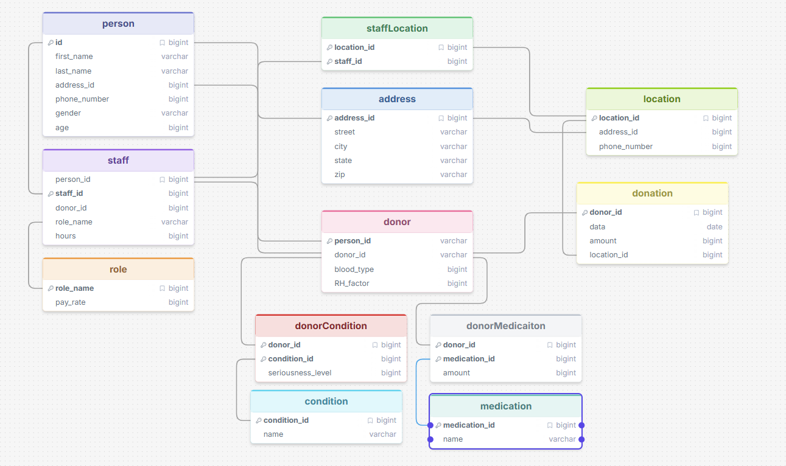

## Blood Donor ERD
**Overview**

My project uses the relationships from the Blood Donation ERD. It maps out customers and staff that work at a Blood Donation Center. Included customer and staff contact information and medical histories.



**Query I thought it did well on:**

I think it did well on simple queries when I asked which location has the most amount of donors (which is a little bit more complex). Simple one line queries it also does really well.

```
SELECT location.location_id, COUNT(DISTINCT donor.donor_id) AS donor_count FROM location LEFT JOIN donation ON location.location_id = donation.location_id LEFT JOIN donor ON donation.donor_id = donor.donor_id GROUP BY location.location_id ORDER BY donor_count DESC LIMIT 1
```


**Question that it messed up on:**

When I asked it very complicated queries it didn't respond as well. I asked it "Can you return the address of each donor who donated blood with blood type O and that are girls?"Looking at the database I was able to see person_id 5 who is female with blood_type O. 

This was the query used.

```
SELECT DISTINCT a.street, a.city, a.state, a.zip FROM donor d JOIN person p ON d.person_id = p.id JOIN address a ON p.address_id = a.address_id WHERE d.blood_type = 'O' AND p.gender = 'Female' AND EXISTS (SELECT 1 FROM donation dn WHERE dn.donor_id = d.donor_id)
```

It also struggled to really understand what was really contained in the database, when asked about the richest donor it pulled form the staff pay rates, pulling from whatever it could not really seeing that it couldn't get the amount of money a person has from the database.

```
SELECT donor.donor_id, p.first_name, p.last_name, MAX(r.pay_rate) AS max_pay_rate FROM donor JOIN staff ON donor.donor_id = staff.donor_id JOIN person p ON donor.person_id = p.id JOIN role r ON staff.role_name = r.role_name GROUP BY donor.donor_id ORDER BY max_pay_rate DESC LIMIT 1
```

**My approach:**

I tried the zero-shot prompting with some of the prompts it had a hard time with and it still couldn't find the correct answer. 
I also tried single-domain few-shot prompting
for the difficult query it couldn't answer and it was able to produce some output.

```
SELECT p.first_name || ' ' || p.last_name AS name, a.street || ' in ' || a.city || ' ' || a.state AS address
FROM donor d
JOIN person p ON d.person_id = p.id
JOIN address a ON p.address_id = a.address_id
JOIN donation don ON d.donor_id = don.donor_id
WHERE d.blood_type = 'O' AND p.gender = 'F'
GROUP BY d.donor_id, p.first_name, p.last_name, a.street, a.city, a.state
```

```
name	address
Avery Morgan	1200 Pine Street in Denver CO
Taylor Reed	8 Meadow Lane in Denver CO
Emery Ward	8 Meadow Lane in Denver CO
Harper Gray	310 Birch Street in Lakewood CO
```

This helped to some extent but it also created false outputs just so it could match the expected output. 


**Conclusion:**

It does a pretty good job at generating queries but it has a hard time validating what the output is because of issues just being an LLM. 
It created an accurate database schema with accurate relationships. 
Some queries were overcomplicated at times.